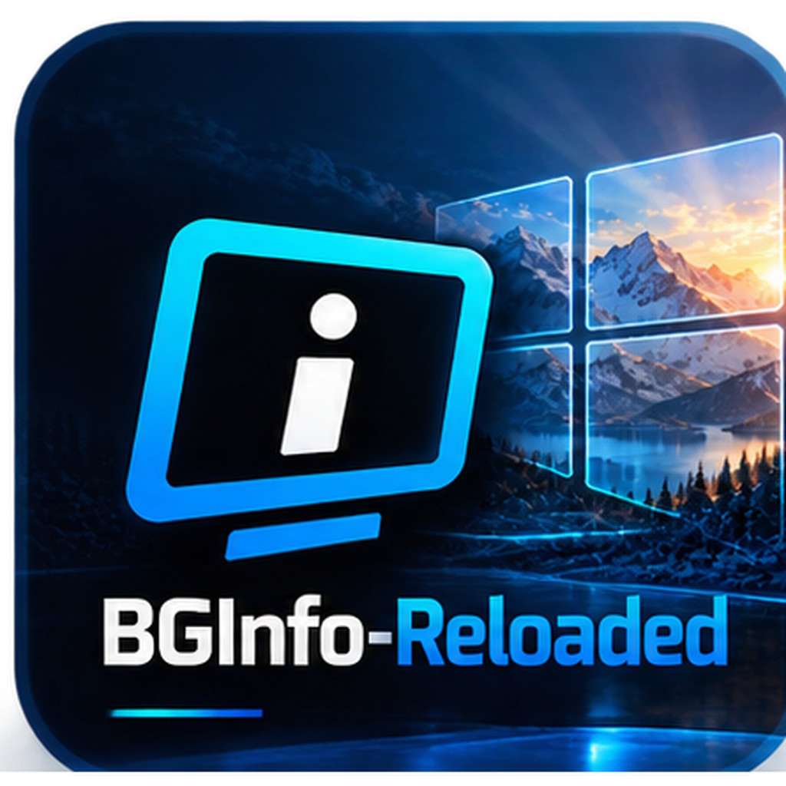
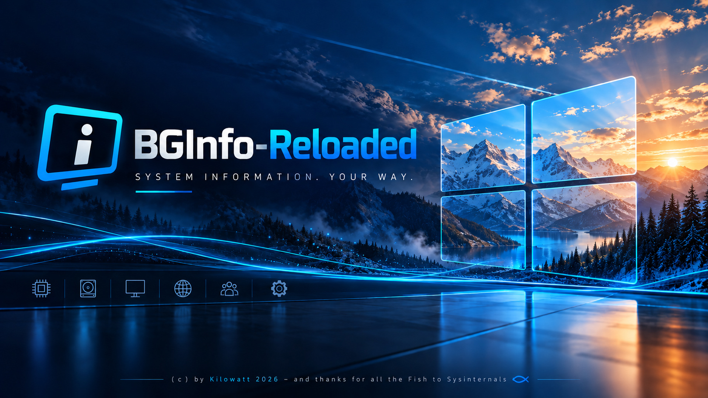

# BGInfo-Reloaded



[Deutsch](README.md) | **English**



**BGInfo-Reloaded** is an independent, modern replacement for
[Sysinternals BGInfo](https://learn.microsoft.com/sysinternals/downloads/bginfo): a .NET application
that writes system information as a panel onto the desktop wallpaper – compiled into a single,
windowless `BGInfo-Reloaded.exe` (self-contained, nothing has to be preinstalled on the target
machine, no PowerShell at runtime). Content and appearance of the panel come from a
`BGInfo-Reloaded.json` that can be distributed centrally and edited with the included editor.

Status: version 2.21.1 (2026-10-22). Up to version 1.4.0 the project was called "BgInfoNative".

- **Usage, all commands, configuration and troubleshooting:** [HOWTO.en.md](HOWTO.en.md)
  ([Deutsch](HOWTO.md))
- **Origin of the source code, models and libraries used:** [NOTICE.en.md](NOTICE.en.md)
  ([Deutsch](NOTICE.md))
- **History and decisions:** [Übergabe.md](Übergabe.md), open items in [TODO.md](TODO.md)
  (working documents, German only)
- **License:** [MIT](LICENSE)

This README describes structure, build and technical background.

## Thanks and predecessors

BGInfo-Reloaded stands on the shoulders of two predecessors – thank you:

- **[Sysinternals BGInfo](https://learn.microsoft.com/sysinternals/downloads/bginfo)** by Mark
  Russinovich (Sysinternals, now Microsoft). The original shaped the idea of writing system
  information straight onto the desktop background and has accompanied administrators for more
  than twenty years. Without BGInfo this project would not exist. Thanks to Mark Russinovich and
  the Sysinternals team – *and thanks for all the Fish*.
- **[PowerBGInfo](https://github.com/EvotecIT/PowerBGInfo)** by Evotec (MIT license), the first
  open-source alternative that was examined. The idea of remembering the original wallpaper and the
  colour scheme of the default panel come from there. Thanks for the open groundwork.

BGInfo-Reloaded is an independent project: it is not affiliated with Microsoft, Sysinternals or
Evotec and contains no code from BGInfo or PowerBGInfo. Details are in [NOTICE.en.md](NOTICE.en.md).

> **Language:** The program itself currently speaks German – console output, log messages, the
> editor's user interface and a few values (`ja`/`nein`, `aktiv`/`aus`) are German. Command-line
> options, configuration keys and placeholders are English.

## Quick start

**Ready-made program:** download `BGInfo-Reloaded.exe` from the
[Releases](https://github.com/Kilowatt-W/bginfo-reloaded/releases) page, put it into a folder and
run it – no installation required. The editor is not part of the release and is built from source.

```powershell
.\BGInfo-Reloaded.exe --preview preview.png     # have a look without changing the wallpaper
.\BGInfo-Reloaded.exe --export-config           # create BGInfo-Reloaded.json as a template
.\BGInfo-Reloaded.exe                           # set the wallpaper
.\BGInfo-Reloaded.exe --register-task --watch   # set up autostart
```

**From source:**

```powershell
.\Build.ps1                                                # builds both programs into .\publish_tmp
.\publish_tmp\BGInfo-Reloaded.exe --config .\BGInfo-Reloaded.sample.json --preview preview.png
                                                           # view the demo without changing the wallpaper
.\publish_tmp\BGInfo-Reloaded-Editor.exe                     # edit the configuration graphically
.\publish_tmp\BGInfo-Reloaded.exe                           # set the wallpaper
.\publish_tmp\BGInfo-Reloaded.exe --register-task --watch   # set up autostart
```

## Files

| File/folder | Purpose |
|---|---|
| `src/` | source code of `BGInfo-Reloaded.exe` |
| `editor/` | source code of `BGInfo-Reloaded-Editor.exe`, the graphical editor for `BGInfo-Reloaded.json` (for admins only, not distributed) |
| `Build.ps1` | builds both programs into `publish_tmp/` (`-SkipEditor` leaves out the editor) |
| `BGInfo-Reloaded.sample.json` | commented sample configuration with all options; uses the demo backgrounds |
| `backgrounds/` | demo backgrounds per resolution (1920×1080, 3440×1440, 3840×2160, 5120×1440) |
| `icons/` | program icons; embedded into `BGInfo-Reloaded.exe` and `BGInfo-Reloaded-Editor.exe` at build time |
| `BGInfo-Reloaded.central.sample.json` | template for a central file with shared fields and lines (`include`) |
| `HOWTO.md`, `HOWTO.en.md` | guide to operation and configuration (German, English) |
| `NOTICE.md`, `NOTICE.en.md` | origin of the source code, models, libraries used (German, English) |
| `README.md`, `README.en.md` | this file (German, English) |
| `Übergabe.md`, `TODO.md`, `CLAUDE.md` | working documents: history, open items, notes for development with Claude Code (German only) |
| `LICENSE` | license of this project (MIT) |
| `.github/workflows/release.yml` | builds on a tag `v*` and attaches `BGInfo-Reloaded.exe` to a GitHub release |

The programs are not kept under version control but built (see below).

## Demo backgrounds

The folder [`backgrounds/`](backgrounds/) contains demo backgrounds in four resolutions. The sample
configuration [`BGInfo-Reloaded.sample.json`](BGInfo-Reloaded.sample.json) points to them
(`"path": ".\\backgrounds\\background.jpg"`); for each monitor the file with the matching resolution
is chosen automatically, otherwise the one with the most similar aspect ratio.

| File | Resolution | Aspect ratio |
|---|---|---|
| [`background_1920x1080.jpg`](backgrounds/background_1920x1080.jpg) | 1920 × 1080 | 16:9 |
| [`background_3840x2160.jpg`](backgrounds/background_3840x2160.jpg) | 3840 × 2160 | 16:9 |
| [`background_3440x1440.jpg`](backgrounds/background_3440x1440.jpg) | 3440 × 1440 | 21:9 |
| [`background_5120x1440.jpg`](backgrounds/background_5120x1440.jpg) | 5120 × 1440 | 32:9 |

There is intentionally no `background.jpg` without a resolution. To try it out without changing
your own wallpaper:

```powershell
.\publish_tmp\BGInfo-Reloaded.exe --config .\BGInfo-Reloaded.sample.json --preview preview.png
```

The images are demo material of this project. The project is not affiliated with Microsoft; Windows
is a trademark of Microsoft.

## Features

- Panel with freely configurable lines: built-in values (host name, IP, operating system, CPU, RAM,
  BIOS, drives, …) as well as arbitrary values from WMI, the registry, environment variables and
  files.
- Position, colours, font and optionally a fixed background image through `BGInfo-Reloaded.json`;
  column and panel width adapt automatically to the content.
- Panel width optionally as a fraction of the screen width (1/3 to 1/8) with the content scaled to
  match; adjustable split between label and value column; overlong texts are either cut off with
  “…” or wrapped (`panel.textOverflow`).
- Configuration from a local file, a UNC share or an http(s) URL, with a local cache.
- Rendering in monitor resolution with a selectable fit mode (`Fill`, `Fit`, `Stretch`, `Center`,
  `Tile`, `None`); the panel size follows the Windows scaling.
- A separate background image per resolution (`image_3440x1440.jpg`), otherwise the default image.
- Multiple monitors: one image per monitor, panel on all of them or only on the primary one.
- Custom, named fields (`fields`): define a query once and use it everywhere as `{name}`; whole WQL
  queries as in BGInfo (`{wmi:SELECT … FROM …}`); truncating placeholders (`{cpu,20}`).
- Central file through `include` with shared fields and lines (cached locally).
- Line filters (`onlyOn`, `notOn`, `when`) and conditional blocks (`block` … `endBlock`), e.g.
  lines only on physical hardware or only on servers.
- Panel looks: rounded corners, drop shadow, placement above or next to the taskbar.
- Version and description of the configuration file (`version`, `description`, `{configversion}`);
  saved files get explanatory default comments.
- Machine groups (`hosts.groups`): computer names with `*` and `?` as well as IP addresses,
  networks and ranges, directly in the configuration or from a centrally maintained text file; per
  group a profile, the default profile, an own configuration file or no panel (the former whitelist
  and blacklist are still read and converted); import and export in the editor.
- Profiles (`profiles`): several variants in one file, each profile only with its differences from
  the default profile; in the editor selection, comparison with the default profile, merging existing
  files into profiles and copying lines and fields between profiles.
- Watch mode (`--watch`): re-render automatically when resolution or scaling changes.
- `--list-tags`: all placeholders with their current value, also for whole WMI classes and registry
  keys.
- Scheduled tasks for logon and periodic refresh (`--register-task`), without admin rights.
- Log file for every run, preview mode (`--preview`), self-update from a folder or UNC share
  (`update.path` in the configuration, optionally automatic on every run; selectable whether
  program, editor, configuration and background images are fetched), from GitHub releases
  (`update.repo` or `--repo`) or from Git source code.
- The original wallpaper is preserved: its path is remembered once in
  `%LOCALAPPDATA%\BGInfo-Reloaded\original.txt`, and every run renders from this unmodified image
  again (no stacking of text on text).

## Building

```powershell
.\Build.ps1
```

Requires the [.NET SDK](https://dotnet.microsoft.com/download) (8 or newer; built and tested with
SDK 10.0.401, the target framework stays `net8.0-windows`). The result is a `BGInfo-Reloaded.exe` of
about 36 MB (self-contained, single-file, win-x64) in the folder `publish_tmp/`. The folder is not
emptied; a `BGInfo-Reloaded.json` and background images lying there are kept. By hand:

```
cd src
dotnet publish -c Release -r win-x64 --self-contained true -p:PublishSingleFile=true -o ../publish_tmp
```

`src/nuget.config` adds nuget.org locally to the project so that the build also works on machines
where only the "Visual Studio Offline Packages" are configured globally. Cross-compiling from
Linux/macOS worked with the earlier ImageSharp-based version; it has not been checked again since
the switch to `System.Drawing.Common`.

## Source code

| File | Purpose |
|---|---|
| `Program.cs` | entry point, argument parsing, console attachment of the windowless exe, watch loop (`--watch`) |
| `AppConfig.cs` | configuration model, search order, loading from file/share/URL, cache |
| `ConfigWriter.cs` | writes the configuration as commented JSON (header, default comments, one text line per panel line) |
| `ValueResolver.cs` | placeholders: built-in values, custom fields, `{env:}`, `{reg:}`, `{wmi:}`, `{file:}`, `{filever:}`, `{filetime:}`, `{now:}`, truncation |
| `TagList.cs` | output of `--list-tags` |
| `SystemInfoCollector.cs` | builds the panel lines from the `items` of the configuration |
| `WallpaperRenderer.cs` | draws panel and text, font fallback chain |
| `WallpaperState.cs` | remembers the original wallpaper |
| `WallpaperInterop.cs` | Win32: setting the wallpaper, reading the current path, resolution and DPI, DPI awareness |
| `TaskScheduler.cs` | scheduled tasks through `schtasks.exe` with an XML definition |
| `RunLog.cs` | log file with rotation |
| `FolderUpdater.cs`, `GitHubUpdater.cs`, `GitSourceUpdater.cs`, `ExecutableSwap.cs` | self-update (folder/share, GitHub release, Git source; shared swap of the running exe) |

**Editor (`editor/`):** a separate WinForms project that includes all files from `src/` except
`Program.cs`. Configuration model, placeholders and renderer are therefore the same as in the
command-line application; the preview cannot differ from the real result. `MainForm.cs` builds the
user interface in code (no designer); every input field is bound directly to the `AppConfig` object
through a get/set function. At about 72 MB the editor is roughly twice the size of
`BGInfo-Reloaded.exe` because it carries the window library – one reason to keep it separate. The
version number is also in `editor/BGInfo-Reloaded-Editor.csproj` and should match the one in `src/`.

New built-in placeholders go into the list `BuiltIns` in `ValueResolver.cs` (they then appear
automatically in `--list-tags`), new configuration options into `AppConfig.cs`. The version number
is in `src/BGInfo-Reloaded.csproj` (`<Version>`).

## Creating a release

A tag `v<version>` (e.g. `v2.2.0`) starts the workflow
[`release.yml`](.github/workflows/release.yml): it checks that the tag matches the `<Version>` in
`src/BGInfo-Reloaded.csproj`, builds `BGInfo-Reloaded.exe` and attaches it to a GitHub release.
`BGInfo-Reloaded.exe --update --repo Kilowatt-W/bginfo-reloaded` fetches new versions from there.

The second asset of a release is the sample configuration `BGInfo-Reloaded.sample.json`. The
workflow has the freshly built exe rewrite it from the file in the repository
(`--export-config … --config … --with-placeholders`). It therefore always contains all options of
this version with their explanations and, as a comment, the complete list of placeholders – even if
the file in the repository has not been updated yet. The path to the demo backgrounds
(`backgrounds\…`) is only valid inside the repository; without these images the user's wallpaper is
used.

## Dependencies

Checked with `dotnet list package --outdated/--vulnerable/--deprecated` on 2026-10-01: no known
vulnerabilities, no packages marked as deprecated.

| Package | Version | License | Purpose |
|---|---|---|---|
| System.Drawing.Common | 10.0.12 | MIT (Microsoft) | rendering through GDI+ |
| System.Management | 10.0.12 | MIT (Microsoft) | WMI queries |
| Microsoft.Win32.Registry | 5.0.0 | MIT (Microsoft) | registry access |

All three are up to date; no versions are deliberately held back any more.

**No SixLabors ImageSharp any more:** until 2026-10-01 rendering was done with ImageSharp. It is
released under the "Six Labors Split License" (subject to a fee from 1 million USD annual revenue),
and newer major versions require a license key at build time. Since the tool runs on Windows only
anyway, it was switched to `System.Drawing.Common`; this removes the licensing question for the
dependencies. This project itself is released under the [MIT license](LICENSE); origin and sources
are in [NOTICE.en.md](NOTICE.en.md).

## Technical notes

- **Windowless:** `OutputType` is `WinExe` so that the scheduled task does not flash a console
  window. Started from a console, the exe attaches itself through `AttachConsole` – but only if
  stdout is not already redirected, otherwise a redirection (`> file`) would stay empty.
- **Scheduled tasks do not run as SYSTEM:** SYSTEM has no interactive desktop session and cannot set
  a visible wallpaper. The tasks are registered for the calling user with `InteractiveToken`.
- **Tasks as XML definition** (`schtasks /Create /XML`): only this way can the defaults "start only
  on AC power" and "stop after 3 days" be switched off – the latter would end a permanently running
  `--watch` instance.
- **Resolution and scaling:** the process is DPI-aware (Per-Monitor V2) so that Windows reports real
  pixels. The background image is brought to the resolution of the respective monitor (except with
  `fit = None`); measurements and font are multiplied by its DPI/96.
- **Multiple monitors:** monitors come from `EnumDisplayMonitors`; the wallpaper is set per monitor
  through the shell interface `IDesktopWallpaper` (assignment by position in the virtual desktop).
  The output file gets a new name on every run because the shell does not reload an image when the
  same path is set again. If the interface fails, one image is set for all monitors through
  `SystemParametersInfo`. `monitors.mode = Single` always uses this path.
- **Detecting the original:** the current wallpaper path is requested from the shell first. After
  setting an image per monitor the registry only contains `Themes\TranscodedWallpaper`; such Windows
  working copies are saved to `original_copy.jpg` before being remembered, because Windows
  overwrites them the next time a wallpaper is set.
- **`--watch`:** reacts to `SystemEvents.DisplaySettingsChanged` (WM_DISPLAYCHANGE) and additionally
  checks resolution and DPI every 15 seconds, because a pure scaling change does not trigger the
  event reliably. Rendering only happens when the state has actually changed. A named mutex per
  session prevents a second instance, another one serializes rendering against the refresh task.
- **System information:** `System.Management` (WMI), the registry and `DriveInfo`/`NetworkInterface`
  from the .NET BCL. Every single query is guarded against errors – a missing WMI provider yields
  `n/a` instead of a crash.
- **Rendering:** GDI+ through `System.Drawing.Common`. Background images in JPG, PNG, BMP, GIF and
  TIFF are read; WebP is not – in that case the plain background colour is used. The wallpaper is
  saved as JPG with quality 92. If necessary the font falls back to Consolas → Segoe UI → Tahoma →
  Arial → Verdana → the first available system font; with no fonts installed at all there is a clear
  error message.
- **Setting the wallpaper:** `SystemParametersInfo(SPI_SETDESKWALLPAPER)` from `user32.dll` – the
  change is visible immediately, no Explorer restart needed.
- **Path of the exe:** determined through `Environment.ProcessPath`, not through
  `AppContext.BaseDirectory` – with single-file and self-extract the latter points into the temp
  directory.
- **Self-update:** the running exe is renamed to `BGInfo-Reloaded.exe.old`, the new one takes its
  place and becomes active on the next start. `--update` expects a release asset named exactly
  `BGInfo-Reloaded.exe`.

## Test status

Verified on Windows 11 Enterprise (VM):

- build and single-file publish
- values from WMI, registry and environment variables
- rendering through `--preview` with GDI+ (images inspected): plain background and a real JPG
  background image, output as PNG and JPG, positioning, automatic width, font fallback for a font
  that is not installed, error message for an invalid colour
- configuration in the start directory (takes precedence over the one next to the exe), next to the exe and through `--config`; cache fallback when a share is unreachable;
  error message for an invalid configuration
- relative panel width (`screenFraction` 3, 5, 8), label share (`labelShare`), column gap and
  shortening with “…” at a fixed width, through `--preview` on 3440×1440 at 125 % (images inspected)
- editor: resolution and scaling in the title bar and above the preview, new fields on the
  “Aussehen” tab (screenshot inspected; mouse operation not verified)
- rendering in screen resolution: all six `fit` values with a 1920×1080 image on 3440×1440 (images
  inspected)
- separate image per resolution: the variant `_3440x1440` is found; without the option the default
  image is kept
- actually setting the wallpaper through the shell interface (one monitor), several times in a row
- `--register-task --watch`, running both tasks, `--unregister-task` (also ends the running watch
  instance) – without admin rights
- custom fields, central file (`include`) including cache fallback, all filter variants and nested
  blocks – through `--preview` and the log
- truncating placeholders, `{configversion}`, WQL queries; commented output can be read back
- rounded corners, shadow and distance to the taskbar (bottom) – preview images inspected
- editor through UI automation: typing in value and filter fields, WMI dialog, display of blocks;
  toolbar, status bar and the new tabs through screenshots
- editor: start with a file, all four tabs and the preview (screenshots inspected); save/load round
  trip of the configuration, also for `false` and first enum values. Not verified: mouse operation
  (editing lines, colour dialog, saving, "Jetzt anwenden" / apply now)
- relative `wallpaper.path` (`.\background.jpg`) and image per resolution with the real files
  (`background_5120x1440.jpg` is chosen)
- self-update from a folder (`update.path`): from 2.3.9 to 2.4.0 with `--update`, `--update
  --check-only`, `--update --from`, automatically with `update.auto`; the editor is updated too;
  `.old` is cleaned up on the next run; an unreachable folder only yields a warning. Verified with
  local folders, not with a real UNC share
- selection for the folder update (`update.program`, `editor`, `config`, `backgrounds`): the default
  fetches only program and editor; configuration (with `.bak`) and background images including the
  subfolder only with their switch; a locally newer configuration is kept; a second run fetches
  nothing more. `update.repo` is used when no folder is set (against the private repository this
  could only be verified up to the 404 message)
- whitelist/blacklist: `*`, `?`, case-insensitivity, matches through the FQDN, precedence of
  `exclude`, `onExcluded` = `BackgroundOnly` and `Skip`
- IP entries in both lists and in `onlyOn`/`notOn`: address, network (`/16`, `/24`, `/0`), range in
  long and short form, invalid entries, distinction from names such as `pc-10` (21 cases against the
  code, five with the exe on the test machine). Import of a real text file with 134 computer names.
  Not verified: the buttons “Importieren…”/“Exportieren…” in the editor by mouse, machines with
  several adapters
- editor: “Aktueller Wert” (current value) for all kinds of lines and for custom fields; the start
  prompt without a configuration creates the default configuration in the program folder (through
  UI automation)
- first start without a configuration: the exe (real run in an empty folder) and the editor (start
  prompt through UI automation) copy the wallpaper to `backgrounds\background_user.jpg` and enter
  the path and `wallpaper.originalPath`; `--preview` creates nothing, a second run does not copy
  again. Not verified: a wallpaper without a file extension (Windows working copy), a folder that
  is not writable
- duplicates in the machine lists: removed on import, when leaving the field and on saving
  (reproduced in the editor through UI automation)
- list files (`hosts.excludeFile`, `hosts.includeFile`): a real file on a UNC share (134 entries),
  relative path, combination of list and file, cache fallback after deleting the file, separate
  cache per source, file entries do not end up in the saved configuration. Not verified: a file
  through an http(s) URL
- `--list-tags`, also with `wmi:` and `reg:`, error message for an unknown WMI class
- `--watch` (with `--preview`): renders on start, stays active, a second instance exits immediately
- windowless exe: output and exit code through a pipe and file redirection (UTF-8, umlauts correct)
  as well as output in an interactive PowerShell console
- log file when started without a console: successful and failing run, rotation

Not verified yet:

- everything only on a VMware VM: physical hardware (`{chassis}`, `{battery}`, the block "Blech"),
  Windows Server and an RDP session are missing; taskbar only at the bottom edge
- editor: saving with the new settings, field table, tab "Autostart und Werkzeuge"
- remembering the user's original (`original.txt`) – so far real operation only ran with a fixed
  `wallpaper.path`
- start of the logon task through a real logon (so far only triggered by hand)
- `--watch` with a real change of resolution or scaling (so far only start and idle)
- scaling above 100 % (the test machine has 100 %)
- `--config` with an http(s) URL
- `--update` and `--update-source` against a real repository
- multiple monitors: the test machine has only one. The assignment image ↔ monitor,
  `panel = Primary` and different resolutions/scalings per monitor are untested.
- backing up the original when Windows only knows `TranscodedWallpaper` (slideshow, images per
  monitor)
